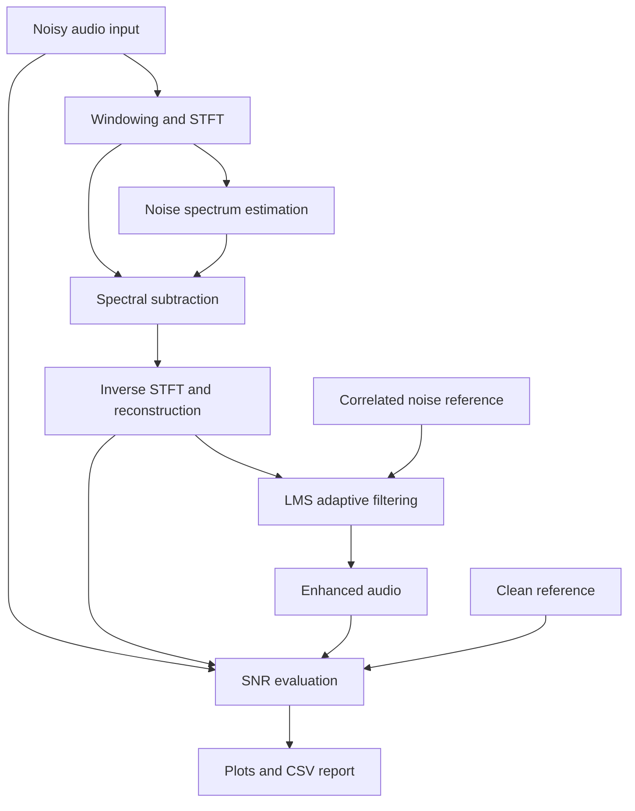

🎙️ Studio Signal Noise Cancellation System Using MATLAB
A MATLAB-based digital signal processing system designed to reduce background noise and enhance speech signals using Short-Time Fourier Transform (STFT), spectral subtraction and Least Mean Squares (LMS) adaptive filtering.

The project combines frequency-domain analysis and adaptive noise cancellation in a two-stage audio processing pipeline.

🔗 GitHub Repository: Studio-Signal-Noise-Cancellation
🚀 Overview
Unwanted background noise can significantly affect the quality and intelligibility of recorded speech. This project explores a hybrid signal enhancement approach that estimates stationary noise in the frequency domain and uses adaptive filtering to suppress residual noise.

The system is designed to:
- Analyze noisy audio signals.
- Estimate background noise using spectral analysis.
- Perform STFT-based spectral subtraction.
- Implement reference-based LMS adaptive filtering.
- Compare signal quality using Signal-to-Noise Ratio (SNR).
- Generate enhanced audio files and waveform visualizations.
💡 Problem Statement
Audio recordings are often affected by fan noise, electrical hum and environmental disturbances. Conventional fixed filters may remove useful speech components when noise and speech occupy overlapping frequency ranges.

The observed signal is modeled as:

\(y(n)=s(n)+v(n)\)

Where:
- $y(n)$ — observed noisy signal
- $s(n)$ — clean speech signal
- $v(n)$ — additive noise
The objective is to estimate the original speech signal while minimizing unwanted noise and preserving useful audio information.
🎯 Solution
The proposed system combines two complementary signal processing techniques:
- Spectral Subtraction: Estimates and suppresses stationary background noise in the frequency domain.
- LMS Adaptive Filtering: Uses a correlated noise reference to estimate and reduce residual noise in the time domain.
The two-stage approach is evaluated against the noisy input and the spectral-only output to investigate its effectiveness.
✨ Features Implemented
🎧 Audio Signal Processing
- WAV audio input and output
- Synthetic speech demonstration dataset
- Clean, noisy and correlated noise reference signals
- Offline audio enhancement pipeline
📡 Frequency-Domain Analysis
- Short-Time Fourier Transform using FFT
- Window-based signal segmentation
- Noise magnitude spectrum estimation
- Magnitude spectral subtraction
- Inverse FFT and weighted overlap-add reconstruction
⚙️ Adaptive Noise Cancellation
- Least Mean Squares (LMS) algorithm
- 32-tap adaptive FIR filter
- Dynamic filter coefficient updates
- Reference-based residual noise estimation
📊 Performance Evaluation
- SNR calculation against a clean reference
- Comparison of three processing stages
- Waveform comparison plots
- SNR bar chart
- CSV export of numerical metrics
📂 Audio Output Generation
- Spectral subtraction output
- Hybrid spectral subtraction and LMS output
- Automatic result file generation
🛠️ Tech Stack
Programming & Development
- MATLAB (R2024b recommended)
- MATLAB scripting and modular functions
- Git and GitHub
Signal Processing Techniques
- Fast Fourier Transform (FFT)
- Inverse Fast Fourier Transform (IFFT)
- Short-Time Fourier Transform (STFT)
- Spectral Subtraction
- Least Mean Squares (LMS)
- Adaptive FIR Filtering
- Signal-to-Noise Ratio (SNR)
The repository implementation uses base MATLAB functions and explicit LMS coefficient updates. No additional toolbox is required by the supplied scripts.
🏗️ System Architecture

🔬 Methodology
1️⃣ Audio Input
The demonstration loads three aligned WAV files: noisy speech, clean reference speech and a correlated noise reference. The clean reference is used for evaluation, not as an input to the enhancement algorithms.
2️⃣ STFT and Noise Estimation
The noisy signal is divided into overlapping frames and transformed into the frequency domain. The noise magnitude spectrum is estimated from frames within the first 0.5 seconds, which contain noise only.
3️⃣ Spectral Subtraction
The estimated noise magnitude is subtracted from each noisy magnitude spectrum. A spectral floor limits excessive attenuation, and the original phase is retained.

\(\hat{S}(k,m)=\max(|Y(k,m)|-|\hat{V}(k)|,\beta|Y(k,m)|)e^{j\angle Y(k,m)}\)

The enhanced time-domain signal is reconstructed using inverse FFT and weighted overlap-add.
4️⃣ LMS Adaptive Filtering
The spectral-stage output becomes the primary signal. A separate correlated noise reference is used to estimate the remaining noise.

\(\hat{v}(n)=\mathbf{w}^{T}(n)\mathbf{u}(n)\)

\(e(n)=d(n)-\hat{v}(n)\)

\(\mathbf{w}(n+1)=\mathbf{w}(n)+\mu e(n)\mathbf{u}(n)\)

Where:
- $d(n)$ — spectral-stage output
- $\mathbf{u}(n)$ — noise reference vector
- $\mathbf{w}(n)$ — adaptive filter weights
- $\mu$ — step size
- $e(n)$ — enhanced output signal
5️⃣ Output and Evaluation
The system exports enhanced audio and compares the noisy, spectral-only and hybrid signals using SNR and waveform plots.
⚙️ System Configuration
Parameter	Value
Demo sampling rate	16 kHz
Frame duration	32 ms
Frame overlap	50%
FFT size	Next power of two of frame length
Noise estimation interval	0.5 seconds
Spectral floor	5% of noisy magnitude
LMS filter length	32 taps
LMS step size	0.01
Processing mode	Offline

📁 Project Structure
Studio-Signal-Noise-Cancellation/
│
├── audio/
│   ├── clean_reference.wav
│   ├── noise_reference.wav
│   └── noisy_audio.wav
│
├── src/
│   ├── spectral_subtraction.m
│   └── lms_cancel.m
│
├── results/
│   └── .gitkeep
│
├── run_demo.m
├── README.md
└── .gitignore
⚙️ Installation & Setup
1️⃣ Clone Repository
git clone https://github.com/srishtii26/Studio-Signal-Noise-Cancellation.git
2️⃣ Navigate Into Project
cd Studio-Signal-Noise-Cancellation
3️⃣ Open MATLAB
Set the MATLAB Current Folder to the project directory containing run_demo.m. If the repository contains a nested project folder, open that folder instead.
4️⃣ Run the Project
Execute the following command in the MATLAB Command Window:
run_demo
5️⃣ View Generated Results
Open the results/ directory after execution to inspect the enhanced audio, graphs and numerical evaluation.
📊 Performance Evaluation
The system uses reference-based Signal-to-Noise Ratio to measure the difference between the processed signal and the original clean signal.

\(\mathrm{SNR}=10\log_{10}\left(\frac{\sum_n s^2(n)}{\sum_n(\hat{s}(n)-s(n))^2}\right)\)

The experiment compares:
Processing stage	Purpose
Noisy input	Establish baseline SNR
Spectral subtraction	Evaluate frequency-domain noise suppression
Spectral subtraction + LMS	Evaluate the combined approach

Higher SNR indicates a smaller error relative to the clean reference. Improvement depends on the noise characteristics and filter configuration.

Numerical results will be generated when the demo is executed. MATLAB execution has not yet been verified for this reconstructed repository, and no measured SNR improvement is claimed.
📸 Generated Outputs
File	Description
results/spectral_audio.wav	First-stage enhanced audio
results/cleaned_audio.wav	Final hybrid output
results/waveforms.png	Clean, noisy and enhanced waveform comparison
results/snr.png	SNR comparison bar chart
results/snr.csv	Numerical SNR values for all three stages

These files are generated locally and excluded from Git tracking by default. Verified plots can be added to the repository after running the experiment.
🌍 Real-World Applications
Potential applications of the techniques explored in this project include:
- Studio audio post-processing
- Speech enhancement for communication systems
- Podcast and voice recording cleanup
- Acoustic signal analysis
- Audio preprocessing for speech recognition
- Digital signal processing research and education
⚠️ Implementation Notes & Limitations
- This repository contains a reconstructed and expanded implementation based on the original academic project report, rather than a recovered copy of its source code.
- The original report's illustrative LMS snippet uses the same signal as input and desired signal. This implementation uses a separate correlated noise reference instead.
- The included demonstration uses synthesized speech and simulated hum and random noise, not real studio recordings.
- Real-world use requires a suitable noise-only interval for spectral subtraction and an aligned correlated noise reference for LMS.
- The current system processes audio offline and is not a real-time studio plugin.
📌 Future Improvements
- 🎙️ Real-time microphone-based noise cancellation
- 📈 LMS and NLMS performance comparison
- 🔊 Evaluation using real-world speech recordings
- 📊 Spectrogram-based visual analysis
- 🧪 Additional evaluation metrics such as MSE and STOI
- 🤖 Machine learning-based speech enhancement
- 🖥️ Interactive MATLAB App Designer interface
- ⚡ Embedded DSP implementation
🧠 Learning Outcomes
The project explores practical concepts in:
- Time-domain and frequency-domain signal analysis
- Fourier transforms and signal reconstruction
- Noise estimation and spectral processing
- Adaptive filter design and LMS algorithms
- MATLAB-based audio processing
- Quantitative signal quality evaluation
- Modular implementation and experimental documentation
📚 References
1. B. Widrow and M. E. Hoff, Adaptive Switching Circuits, 1960.
2. S. F. Boll, Suppression of Acoustic Noise in Speech Using Spectral Subtraction, IEEE Transactions on Acoustics, Speech, and Signal Processing, 1979.
🎓 Academic Project Details
- Course: Signals and Systems Laboratory (ELC433)
- Academic Year: 2025–26
- Semester: IV
- Institution: CHRIST (Deemed to be University), Bengaluru
- Faculty In-Charge: Syam Chandran K
👥 Project Team
- Nevin Varghese
- Niwin Pranav M V
- Rashmika Ramachandran
- Srishti S Rao
📬 Feedback
Suggestions and technical feedback are welcome. Feel free to open an issue on GitHub to discuss improvements or experimental observations.
📬 Contact
📧 Email: srishtisrao26@gmail.com

💼 LinkedIn: Srishti S Rao

💻 GitHub: srishtii26
⭐ Support
If you find this project useful, consider giving it a ⭐ on GitHub!
👩‍💻 Repository Maintainer
Srishti S Rao

B.Tech – Electronics and Computer Science Engineering (AI/ML Specialization)

CHRIST (Deemed to be University)

Bengaluru, India
