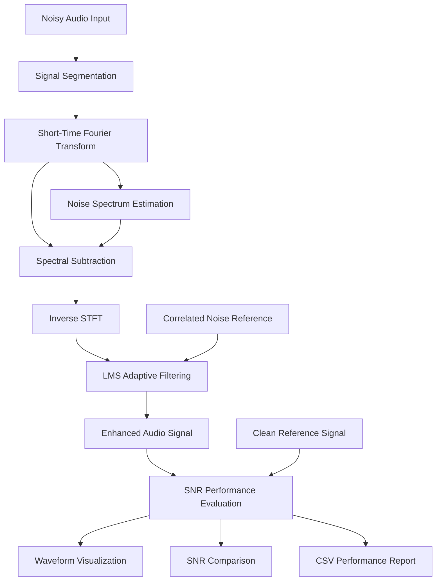

# 🎙️ Studio Signal Noise Cancellation System Using MATLAB

A MATLAB-based Digital Signal Processing (DSP) system designed to reduce background noise and enhance speech signals using Short-Time Fourier Transform (STFT), Spectral Subtraction and Least Mean Squares (LMS) Adaptive Filtering.

The project combines frequency-domain signal analysis and time-domain adaptive filtering to explore efficient noise cancellation and audio signal enhancement.

🔗 GitHub Repository:\
[Studio-Signal-Noise-Cancellation](https://github.com/srishtii26/Studio-Signal-Noise-Cancellation)

---

# 🚀 Overview

Unwanted background noise significantly affects the quality and intelligibility of recorded audio signals.

This project implements a hybrid noise cancellation system using two complementary digital signal processing techniques:

- STFT-Based Spectral Subtraction
- LMS Adaptive Noise Cancellation

The system is designed to:

- Analyze noisy audio signals
- Estimate background noise
- Perform frequency-domain signal processing
- Suppress stationary noise components
- Reduce residual noise using adaptive filtering
- Evaluate signal quality using SNR
- Generate enhanced audio signals
- Visualize signal processing results

Built using MATLAB and fundamental Digital Signal Processing algorithms.

---

# 💡 Problem Statement

Modern audio recording and communication systems are frequently affected by unwanted background noise.

Common noise sources include:

- Electrical interference
- Fan and machinery noise
- Environmental disturbances
- Background acoustic noise
- Random signal interference
- Electrical hum

Traditional fixed filtering techniques may be ineffective when speech and noise occupy overlapping frequency ranges.

The noisy signal is mathematically represented as:

$$y(n)=s(n)+v(n)$$

Where:

- $y(n)$ — Observed noisy signal
- $s(n)$ — Original clean signal
- $v(n)$ — Additive noise component

The primary objective is to estimate the original signal while minimizing unwanted noise and preserving useful audio information.

---

# 🎯 Solution

The proposed system addresses these challenges using a two-stage hybrid noise cancellation architecture.

## Stage 1 — Spectral Subtraction

- Frequency-domain signal analysis
- Background noise spectrum estimation
- Stationary noise suppression
- Signal reconstruction

## Stage 2 — LMS Adaptive Filtering

- Adaptive noise estimation
- Dynamic filter coefficient adjustment
- Residual noise suppression
- Reference-based signal enhancement

The combined approach is designed to investigate noise reduction while preserving important signal characteristics.

---

# ✨ Features Implemented

## 🎧 Audio Signal Processing

- WAV Audio Input
- Audio Signal Loading
- Synthetic Speech Demonstration
- Clean Reference Signal
- Noisy Audio Signal
- Correlated Noise Reference
- Offline Audio Processing

---

## 📡 Frequency-Domain Analysis

- Fast Fourier Transform (FFT)
- Inverse Fast Fourier Transform (IFFT)
- Short-Time Fourier Transform (STFT)
- Window-Based Signal Segmentation
- Noise Spectrum Estimation
- Frequency-Domain Spectral Subtraction
- Signal Reconstruction

---

## ⚙️ Adaptive Noise Cancellation

- Least Mean Squares (LMS) Algorithm
- Adaptive FIR Filtering
- 32-Tap Adaptive Filter
- Dynamic Weight Adjustment
- Error Signal Calculation
- Reference-Based Noise Estimation
- Residual Noise Suppression

---

## 📊 Performance Evaluation

- Signal-to-Noise Ratio (SNR) Calculation
- Input Signal Quality Evaluation
- Spectral Subtraction Evaluation
- Hybrid Filtering Evaluation
- Waveform Comparison
- SNR Comparison Graph
- Numerical Results Export

---

## 📂 Audio Output Management

- Automatic Audio File Generation
- Spectral Subtraction Audio Output
- Final Noise-Cancelled Audio Output
- Graph Generation
- CSV-Based Performance Report

---

# 🛠️ Tech Stack

## Programming Language

- MATLAB

## Development Environment

- MATLAB R2024b (Recommended)
- Visual Studio Code

## Signal Processing Techniques

- Digital Signal Processing (DSP)
- Fast Fourier Transform (FFT)
- Inverse Fast Fourier Transform (IFFT)
- Short-Time Fourier Transform (STFT)
- Spectral Subtraction
- Least Mean Squares (LMS)
- Adaptive FIR Filtering
- Signal-to-Noise Ratio (SNR)

## Version Control

- Git
- GitHub

The repository implementation uses base MATLAB functions and explicit adaptive filter coefficient updates.

---

# 🏗️ System Architecture



---

# 🔬 Project Methodology

## 1️⃣ Audio Signal Acquisition

The system loads three audio signals:

- Original clean reference signal
- Noise-corrupted audio signal
- Correlated noise reference signal

The clean reference signal is used for performance evaluation rather than as an input to the enhancement algorithms.

---

## 2️⃣ Short-Time Fourier Transform (STFT)

The noisy audio signal is divided into overlapping frames.

Each frame is transformed into the frequency domain using the Fast Fourier Transform.

STFT enables the analysis of frequency components over short time intervals.

$$Y(k,m)=\sum_n y(n)w(n-mH)e^{-j2\pi kn/N}$$

Where:

- $y(n)$ — Input signal
- $w(n)$ — Window function
- $H$ — Hop size
- $N$ — FFT length
- $k$ — Frequency index
- $m$ — Frame index

---

## 3️⃣ Noise Spectrum Estimation

The background noise spectrum is estimated using the initial noise-only portion of the audio signal.

The estimated noise spectrum is used to identify unwanted frequency components.

This stage helps distinguish stationary background noise from useful signal information.

---

## 4️⃣ Spectral Subtraction

The estimated noise magnitude spectrum is subtracted from the noisy signal magnitude spectrum.

The basic spectral subtraction operation is represented as:

$$|\hat{S}(k)|=|Y(k)|-|\hat{V}(k)|$$

Where:

- $Y(k)$ — Noisy signal spectrum
- $\hat{V}(k)$ — Estimated noise spectrum
- $\hat{S}(k)$ — Estimated clean signal spectrum

A spectral floor is applied to prevent excessive attenuation.

The original phase information is retained during signal reconstruction.

---

## 5️⃣ Signal Reconstruction

The enhanced frequency-domain signal is converted back into the time domain using inverse FFT and weighted overlap-add reconstruction.

The reconstructed signal becomes the input to the adaptive filtering stage.

---

## 6️⃣ LMS Adaptive Filtering

The Least Mean Squares algorithm dynamically adjusts the filter coefficients to estimate residual noise.

The adaptive filter output is calculated as:

$$\hat{v}(n)=\mathbf{w}^{T}(n)\mathbf{u}(n)$$

The error signal is calculated as:

$$e(n)=d(n)-\hat{v}(n)$$

The LMS weight update equation is:

$$\mathbf{w}(n+1)=\mathbf{w}(n)+\mu e(n)\mathbf{u}(n)$$

Where:

- $\mathbf{w}(n)$ — Adaptive filter coefficient vector
- $\mathbf{u}(n)$ — Noise reference vector
- $\mu$ — Step size
- $e(n)$ — Error signal
- $d(n)$ — Spectral subtraction output

The error signal represents the final enhanced audio output.

---

## 7️⃣ Performance Evaluation

The original noisy signal, spectral subtraction output and final hybrid output are compared using Signal-to-Noise Ratio.

Waveform plots and numerical performance reports are generated for further analysis.

---

# ⚙️ System Configuration

| Parameter | Configuration |
|---|---|
| Programming Environment | MATLAB |
| Sampling Frequency | 16 kHz |
| Frame Duration | 32 ms |
| Frame Overlap | 50% |
| FFT Size | Next Power of Two |
| Noise Estimation Duration | 0.5 Seconds |
| Spectral Floor | 5% |
| LMS Filter Length | 32 Taps |
| LMS Step Size | 0.01 |
| Input Audio Format | WAV |
| Output Audio Format | WAV |
| Processing Mode | Offline |
| Evaluation Metric | SNR |

---

# 📁 Project Structure

```text
Studio-Signal-Noise-Cancellation/
│
├── audio/
│   ├── clean_reference.wav
│   ├── noise_reference.wav
│   └── noisy_audio.wav
│
├── src/
│   ├── spectral_subtraction.m
│   └── lms_cancel.m
│
├── results/
│   └── .gitkeep
│
├── run_demo.m
├── README.md
└── .gitignore
```

---

# 📂 File Description

| File | Description |
|---|---|
| run_demo.m | Main project execution script |
| spectral_subtraction.m | Frequency-domain noise reduction algorithm |
| lms_cancel.m | LMS adaptive noise cancellation algorithm |
| clean_reference.wav | Original reference audio |
| noisy_audio.wav | Noise-corrupted input audio |
| noise_reference.wav | Correlated reference noise |
| results/ | Generated audio and performance results |
| README.md | Project documentation |
| .gitignore | Git tracking configuration |

---

# ⚙️ Installation & Setup

## 1️⃣ Clone Repository

```bash
git clone https://github.com/srishtii26/Studio-Signal-Noise-Cancellation.git
```

---

## 2️⃣ Navigate Into Project

```bash
cd Studio-Signal-Noise-Cancellation
```

---

## 3️⃣ Open MATLAB

Launch MATLAB and set the Current Folder to the project directory containing `run_demo.m`.

If the repository contains a nested project directory, navigate into that directory first.

---

## 4️⃣ Verify Project Files

Ensure the following files and folders are available:

```text
audio/
src/
results/
run_demo.m
```

---

## 5️⃣ Run the Project

Execute the following command in the MATLAB Command Window:

```matlab
run_demo
```

The system will perform spectral subtraction, LMS adaptive filtering and performance evaluation.

---

## 6️⃣ View Generated Results

Navigate to the `results/` directory to access:

- Enhanced Audio Files
- Signal Waveform Comparisons
- SNR Comparison Graph
- Numerical Performance Report

---

# 📊 Performance Evaluation

The performance of the noise cancellation system is evaluated using Signal-to-Noise Ratio (SNR).

SNR measures the relationship between useful signal power and noise or reconstruction error power.

$$SNR=10\log_{10}\left(\frac{P_{signal}}{P_{noise}}\right)$$

For reference-based evaluation:

$$SNR=10\log_{10}\left(\frac{\sum_n s^2(n)}{\sum_n(\hat{s}(n)-s(n))^2}\right)$$

Where:

- $s(n)$ — Original clean reference signal
- $\hat{s}(n)$ — Processed signal
- $P_{signal}$ — Signal power
- $P_{noise}$ — Noise or error power

## Performance Comparison

| Processing Stage | Evaluation Purpose |
|---|---|
| Original Noisy Signal | Establish Baseline SNR |
| Spectral Subtraction | Evaluate Stationary Noise Reduction |
| Spectral Subtraction + LMS | Evaluate Hybrid Noise Cancellation |

A higher SNR generally indicates a smaller reconstruction error relative to the clean reference.

Numerical results are generated automatically during MATLAB execution.

The reconstructed repository has not yet been validated through MATLAB execution. No measured SNR improvement is claimed until experimental verification is completed.

---

# 📸 Generated Outputs

The system is designed to generate the following output files:

| Output File | Description |
|---|---|
| spectral_audio.wav | Spectral Subtraction Output |
| cleaned_audio.wav | Final Noise-Cancelled Audio |
| waveforms.png | Signal Waveform Comparison |
| snr.png | SNR Performance Comparison |
| snr.csv | Numerical Performance Report |

## 📈 Waveform Analysis

The generated waveform visualization enables comparison between:

- Original Clean Signal
- Noise-Corrupted Signal
- Spectral Subtraction Output
- Final Enhanced Signal

## 📊 SNR Analysis

The SNR comparison graph enables quantitative evaluation of the individual signal processing stages.

Verified experimental plots can be added after executing the MATLAB demonstration.

---

# 🌟 Technical Highlights

- Hybrid Frequency and Time-Domain Processing
- STFT-Based Noise Spectrum Analysis
- Adaptive Digital Filtering
- Dynamic Filter Coefficient Optimization
- Reference-Based Noise Cancellation
- Mathematical Signal Modeling
- Modular MATLAB Implementation
- Automated Performance Evaluation
- Audio Signal Reconstruction
- Reproducible Demonstration Workflow

---

# 🌍 Real-World Applications

The signal processing techniques explored in this project have potential applications in:

## 🎙️ Audio and Studio Engineering

- Studio Audio Enhancement
- Podcast Noise Reduction
- Voice Recording Enhancement
- Audio Post-Processing

## 📡 Communication Systems

- Voice Communication Enhancement
- Telecommunication Systems
- Acoustic Noise Suppression
- Signal Interference Reduction

## 🤖 Artificial Intelligence

- Speech Recognition Preprocessing
- Voice Assistant Audio Enhancement
- Audio Classification Preprocessing
- Machine Learning-Based Audio Analysis

## 🔬 Engineering and Research

- Digital Signal Processing Research
- Adaptive Filter Design
- Acoustic Signal Analysis
- Frequency-Domain Signal Processing
- Embedded DSP Applications
- Sensor Signal Enhancement

---

# ⚠️ Implementation Notes & Limitations

- This repository contains a reconstructed and expanded implementation based on the original academic project report.
- The demonstration uses synthetic speech and simulated noise rather than real studio recordings.
- Spectral subtraction requires a suitable noise-only interval for noise estimation.
- LMS adaptive noise cancellation requires a correlated noise reference.
- The system currently performs offline audio processing.
- Noise reduction performance depends on noise characteristics and filter configuration.
- Experimental results require verification through MATLAB execution.

---

# 📌 Future Improvements

- 🎙️ Real-Time Microphone-Based Noise Cancellation
- 📈 Normalized LMS (NLMS) Algorithm
- 🔬 LMS and NLMS Performance Comparison
- 🔊 Real-World Speech Dataset Evaluation
- 📊 Spectrogram-Based Signal Visualization
- 🧪 Additional MSE and STOI Evaluation Metrics
- 🤖 Deep Learning-Based Noise Cancellation
- 🧠 Intelligent Adaptive Filtering
- 🖥️ MATLAB App Designer Interface
- ⚡ Embedded DSP Implementation
- 📡 Communication Signal Enhancement
- 🎛️ Dynamic Noise Estimation
- 🔬 Comparative Analysis of Adaptive Filtering Algorithms

---

# 🧠 Learning Outcomes

Through this project, we explored practical concepts in:

- Signals and Systems
- Digital Signal Processing
- Time-Domain Signal Analysis
- Frequency-Domain Signal Analysis
- Fourier Transform Techniques
- Short-Time Fourier Transform
- Noise Spectrum Estimation
- Spectral Subtraction
- Adaptive Filter Design
- Least Mean Squares Algorithm
- Audio Signal Reconstruction
- MATLAB Programming
- Signal Quality Evaluation
- Experimental Analysis
- Engineering Research Documentation

---

# 🔬 Research & Engineering Perspective

This project demonstrates the integration of mathematical signal processing techniques with computational implementation.

The hybrid architecture explores how frequency-domain and adaptive filtering techniques can work together to address noise interference in audio signals.

The project provides a foundation for further exploration in:

- Advanced Digital Signal Processing
- Intelligent Signal Processing
- Adaptive Signal Enhancement
- Communication Engineering
- Acoustic Signal Processing
- Embedded Signal Processing
- AI-Assisted Signal Enhancement

---

# 📚 References

1. Widrow, B., and Hoff, M. E., "Adaptive Switching Circuits", 1960.

2. Boll, S. F., "Suppression of Acoustic Noise in Speech Using Spectral Subtraction", IEEE Transactions on Acoustics, Speech, and Signal Processing, 1979.


---

# 📬 Feedback

Feel free to share your feedback, technical suggestions or potential improvements!

Suggestions related to adaptive filtering, signal processing algorithms and experimental evaluation are always welcome. 🚀

---

# 📬 Contact

📧 Email: [srishtisrao26@gmail.com](mailto:srishtisrao26@gmail.com)

💼 LinkedIn: [Srishti S Rao](https://www.linkedin.com/in/srishti-s-rao-b09189316)

💻 GitHub: [srishtii26](https://github.com/srishtii26)

---

# ⭐ Support

If you find this project interesting or useful, consider giving it a ⭐ on GitHub!

---

# 👩‍💻 Repository Maintainer

**Srishti S Rao**

*B.Tech – Electronics and Computer  Engineering (AI/ML Specialization)*

*CHRIST (Deemed to be University)*

*Bengaluru, India*

---
